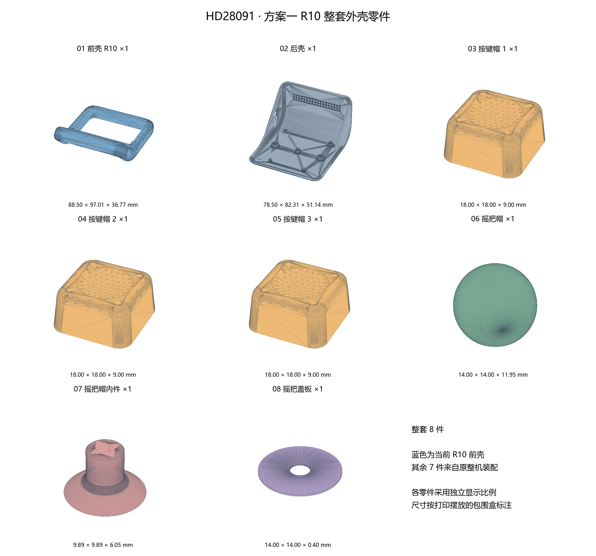

# HD28091 方案一 R10 整套外壳

当前版本为方案一 R10，四处机身外角 R10，面框边缘约 R4.5，摇杆凸台采用抬高前的高度。该目录汇总整套 8 件外壳零件，单位为 mm。

## 配套屏幕与转接板

- 屏幕采用 HD28091C40-V1，480×640 分辨率。[淘宝购买链接](https://item.taobao.com/item.htm?id=566355265504&mi_id=0000sGhHLYPMQHlue9llXrv9IkNEE6YnqL7G8TRNHJ512as&spm=tbpc.boughtlist.suborder_itemtitle.1.70d82e8dXaiCDY)
- 转接板工程已公开在立创开源硬件平台。[转接板工程](https://oshwhub.com/fosen/project_tzekpmhv)
- 项目内的转接板文件和硬件接线说明可分别查看。[转接板资料](../screen-adapter/README.md)、[硬件适配说明](../../docs/hd28091-hardware-adaptation.md)

## 打印文件与数量

| 编号 | 零件 | 数量 | 打印 STL | 原整机中的名称 |
| --- | --- | --- | --- | --- |
| 01 | HD28091 R10 前壳 | 1 | [前壳](HD28091-option1-R10-screen-up.stl) | 上壳-摇把版，经 HD28091 与 R10 外角适配 |
| 02 | 后壳 | 1 | [后壳](HD28091-R10-rear-print.stl) | 底壳-摇把版 |
| 03 | 按键帽 1 | 1 | [按键帽 1](HD28091-R10-button-1-print.stl) | 按键1 |
| 04 | 按键帽 2 | 1 | [按键帽 2](HD28091-R10-button-2-print.stl) | 按键001 |
| 05 | 按键帽 3 | 1 | [按键帽 3](HD28091-R10-button-3-print.stl) | 按键002 |
| 06 | 摇把帽 | 1 | [摇把帽](HD28091-R10-joystick-cap-print.stl) | 摇把帽 |
| 07 | 摇把帽内件 | 1 | [摇把帽内件](HD28091-R10-joystick-insert-print.stl) | 摇把帽001 |
| 08 | 摇把盖板 | 1 | [摇把盖板](HD28091-R10-joystick-cover-print.stl) | 摇把盖板 |

前壳另提供 [screen-up 3MF 打印工程](HD28091-option1-R10-screen-up.3mf)，采用原有的 A1、0.4mm 喷嘴、ABS 起始设置。模型已摆放为屏幕面朝上，打开后根据实际材料和打印机切片。

后壳和小零件的 STL 已独立导出，XY 居中、最低点 Z=0。具有外侧支承平面的零件采用最大支承平面朝下摆放；摇把帽底部为曲面，按安装平面法向摆放，切片时确认支撑方案。将表中 8 个 STL 各导入 1 件可组成一套。预览图中各零件使用独立显示比例，尺寸以切片软件和 `parts-manifest.json` 为准。摇把盖板厚约 0.4mm，切片时确认有效层数和首层设置。

## 装配与 CAD 文件

- [整套装配 STEP](HD28091-R10-assembly.step) 包含当前 R10 前壳和配套 7 件零件，各件保持装配坐标。
- [整套 FreeCAD 工程](HD28091-R10-assembly.FCStd) 中按 01–08 编号命名零件，并记录各自的打印文件及原名称。
- 各零件的 `.step` 文件保持装配坐标，便于单独查看、测量和配合检查。
- 前壳 STEP 与 FreeCAD 中的前壳采用网格转实体表示，包含三角平面；其余 7 件采用原 STEP 实体。

装配时，将三个按键帽分别装入前壳的三个按键开口；摇把帽、内件和盖板按总装中的相对位置配合；安装屏幕、电子元件及连接排线后合上后壳。屏幕使用 HD28091 适配前壳中的安装台阶和排线避让空间，连接器与排线应结合实物检查。

## 文件来源与核验

后壳、三个按键帽及摇把的三个零件原先集中在 `HD28091-enclosure-assembly.step` 内，本次从其中第 2–8 个实体分别导出。前壳使用最后选定的 `option1-r10` 版本。[整理前的整机装配来源](https://github.com/weifuxing/HachimoDock/blob/f7371de62c1b018f5743831edf545f95cd8498a8/hardware/enclosure-hd28091/HD28091-enclosure-assembly.step)

前壳 STL 和 3MF 的 SHA-256 与选定 R10 源文件一致。新导出的零件经过 STEP 回读、实体数与体积核对，STL 检查闭合性、非流形和自交；总装 STEP 与 FreeCAD 工程均包含 8 个实体。各零件的来源编号、打印摆放、尺寸、体积及文件摘要记录在 [parts-manifest.json](parts-manifest.json)。

历史试打、外抬 2mm 和根部 R0.4 方案可从 Git 历史追溯。本目录的打印清单以表中的 8 个 STL 为准；新导出配套件的切片和实物装配验证待完成。
